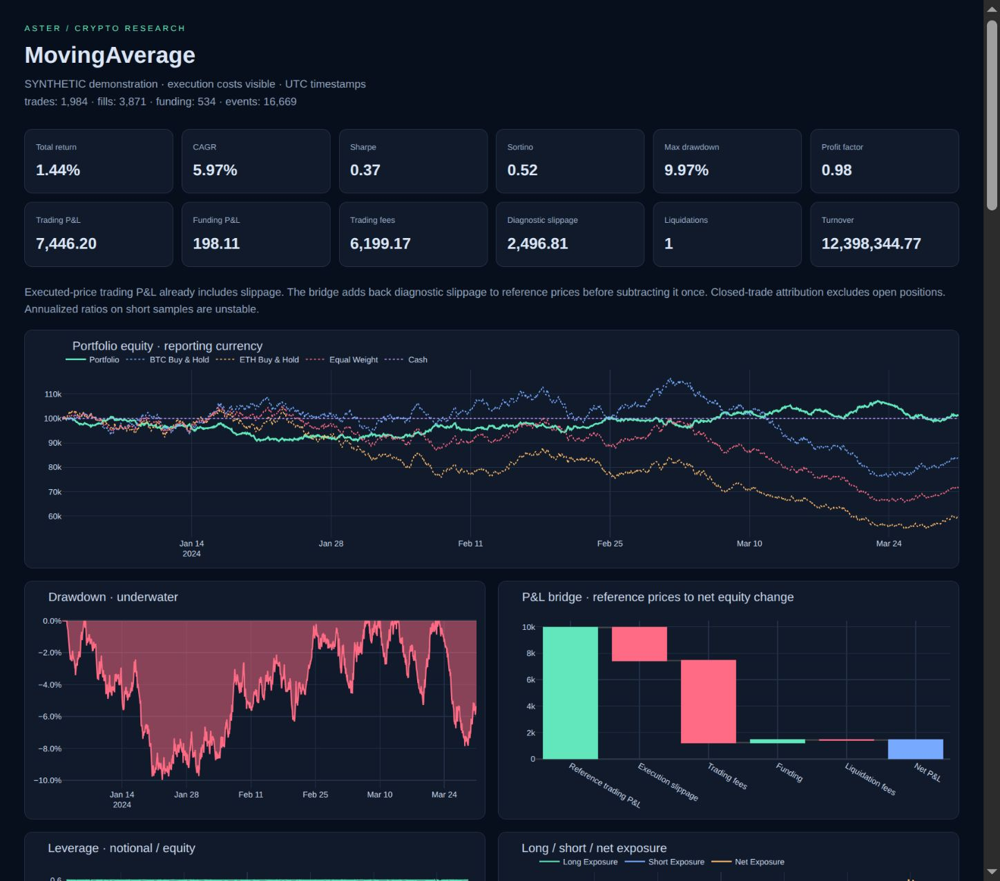
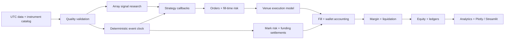

# Aster · Crypto Research

A Python crypto backtesting platform with causal event simulation, vectorized research, explicit execution costs and auditable spot/perpetual accounting.



The implementation prioritizes accounting and timing correctness. **357 tests passed, including independent margin, execution, publication and prospective residual-model regressions.** Independent agents researched 12 frameworks, challenged the design, verified formulas, wrote adversarial tests, audited the finished engine and profiled workloads. Built-in fixtures are synthetic; separately labelled historical examples use verified real data. This is an independently tested research MVP; execution and exchange approximations are explicit.

[User manual](docs/user_manual.md) · [Historical data sources](docs/data_sources.md) · [Real one-year demonstration](docs/real_data_demo.md) · [Private GitHub project](https://github.com/eric2364/aster-crypto)

## Start here

Python 3.12+ and `uv`:

```bash
cd /home/ericwu/Documents/Codex_Backtesting
uv sync --extra dev --extra research
.venv/bin/python -m pytest -q
.venv/bin/python main.py demo --market spot --strategy buy_hold --out results/spot
.venv/bin/python main.py demo --market perpetual --strategy ma --out results/perpetual
.venv/bin/python main.py demo --market perpetual --strategy funding --out results/funding
.venv/bin/streamlit run dashboard.py --server.address 127.0.0.1 --browser.gatherUsageStats false
```

Alternative setup: `python3 -m venv .venv` then `.venv/bin/pip install -e '.[dev,research]'`. `uv.lock` records the resolved dependency environment. The `aster` console command mirrors `main.py` after installation. Launch the dashboard at http://localhost:8501 or open any generated `results/<run>/dashboard.html` offline; HTML includes Plotly without a CDN.

## What is implemented

| Area | Verified behavior |
|---|---|
| Spot | Cash/inventory, long-only, fees, partial entry/exit |
| Perpetuals | Linear quote-margined long/short; weighted entry; realized/unrealized P&L; flips |
| Funding | Timestamped positive/negative settlements; separate cash-flow ledger; no future-rate strategy access |
| Margin | Isolated allocations or per-venue single-currency cross; fill-time margin/leverage checks; maintenance tracking |
| Liquidation | Mark-triggered full close, adverse-price/fee penalty, event log, explicit gap deficits; isolated boundary estimate |
| Orders | Market, limit, stop-market, stop-limit; post-only, reduce-only, GTC, IOC, FOK |
| Execution | Conservative trade-through or opt-in touch; shared participation; maker/taker; price/lot/minimum rules |
| Costs and timing | Fixed/spread/volatility/volume slippage; latency and delay quantized to future bar openings |
| Venues | Binance, Bybit, OKX offline normalization/catalog adapters; separate wallets; no implicit transfers |
| Historical ingestion | Binance checksum-verified spot/perpetual archives, observed mark candles, paginated funding, source manifests |
| Research | Causal array signals, event validation, nine examples, grid search, walk-forward, robustness |
| Reporting | 12 cards, 15 interactive charts, ledger explorer, benchmarks, provenance, CSV and Parquet |

Inverse/dated contracts and live trading are not implemented. Candle data cannot establish real queue priority. See [verified limitations](docs/limitations.md) before interpreting results.

## Architecture



A one-minute candle labelled 12:00 is known in full at 12:01. Its close signal can submit for the next interval's 12:01 open with zero latency. A positive latency skips that open. No order fills at the close that generated it. Opening capacity uses **previously completed volume**, never the new candle's future volume. Simultaneous marks and funding flows are batched before account-wide risk checks.

Perpetual opening does not exchange spot principal. Equity is wallet cash plus spot value plus derivative unrealized P&L; reserved margin is not another expense. Funding is `-signed_quantity × settlement_mark × rate`. Slippage is already embedded in executed prices: the report's reference-price bridge adds it back before displaying it as a separate deduction. Ledgers reconcile total equity, closed lots and open positions.

Use vectorized screening for indicators/parameter exploration. Use the event engine to validate trades, margin, funding and execution. Screening throughput is not event-simulation throughput.

## Research foundations

[NautilusTrader](https://github.com/nautechsystems/nautilus_trader) informed explicit event/order lifecycles; [VectorBT](https://github.com/polakowo/vectorbt) informed array research; [LEAN](https://github.com/QuantConnect/Lean) informed pluggable asset/venue policies; [Hummingbot](https://github.com/hummingbot/hummingbot) informed venue isolation; [HftBacktest](https://github.com/nkaz001/hftbacktest) informed queue/latency limitations. Freqtrade, Jesse, Backtrader, Backtesting.py, Zipline-reloaded, QSTrader and OctoBot were also compared. No project was cloned. [Research report](docs/framework_research.md) includes dated GitHub statistics, source links and capability distinctions.

## Repository map

```text
aster/
  backtest/       models, event engine/context, execution pricing, portfolio/risk/funding
  data/           normalization/validation, CSV/Parquet, synthetic fixtures, future replay schemas
  exchanges/      configurable Binance / Bybit / OKX offline adapters
  strategies/     callback API, causal array API, nine engineering examples
  analytics/      metrics, drawdowns, rolling/monthly/regime statistics, benchmarks/denomination
  optimization/   grid search, holdout walk-forward, cost/liquidity/delay stress
  reports/        Plotly charts, offline HTML, Streamlit app
  cli.py          config/demo command runner
  reproducibility.py  run metadata, hashes, ledger reconciliation, exports
config/ examples/ tests/ benchmarks/ docs/
main.py dashboard.py pyproject.toml uv.lock
```

## Configuration and real data

```bash
.venv/bin/python main.py backtest --config config/spot-buy_hold.yaml
.venv/bin/python main.py backtest --config config/perpetual-ma.yaml
.venv/bin/python main.py backtest --config config/perpetual-funding.yaml
```

Those configs explicitly select synthetic data. For real research replace their data block with:

```yaml
data:
  bars: /absolute/path/bars.parquet
  funding: /absolute/path/funding.parquet
```

Candles require `timestamp,instrument_id,open,high,low,close,volume,duration_seconds`. Timestamps must carry timezone; the engine normalizes to UTC. Derivatives should include observed `mark_open` and end-of-bar `mark_price`. Funding requires exact settlement timestamp, instrument ID, signed per-settlement rate and settlement mark. Supply dated exchange rules and fees rather than treating illustrative defaults as current venue terms. See [data schema](docs/data.md).

No historical listing universe is bundled. Including current surviving tokens alone across past years introduces survivorship and delisting bias. Catalog listing lifetimes support filtering; a researcher's historical universe and dataset coverage remain necessary.

## Real trailing-year demonstration

Downloaded BTCUSDT hourly observations for **5 October 2025–5 October 2026 UTC**: 8,760 spot bars, 8,760 perpetual bars and 1,095 funding records. Each archive was checksum-verified; an official daily mark file repaired one missing monthly day without interpolation. With illustrative fees and fixed parameters, spot MA returned **−12.17%**, perpetual MA **−11.46%**, and the funding example **+5.14%**. These are model outputs, not live execution evidence. Complete assumptions, source manifests and net-cost breakdowns are in [real demo](docs/real_data_demo.md).

```bash
.venv/bin/python examples/download_binance.py --symbol BTCUSDT --interval 1h --start 2025-10-05 --end 2026-10-05 --out data_cache/btc-spot-1y
.venv/bin/python examples/download_binance.py --symbol BTCUSDT --interval 1h --market perpetual --start 2025-10-05 --end 2026-10-05 --out data_cache/btc-perpetual-1y
.venv/bin/python main.py backtest --config config/real-btc-1y.yaml
.venv/bin/python main.py backtest --config config/real-btc-perpetual-1y.yaml
.venv/bin/python main.py backtest --config config/real-btc-funding-1y.yaml
```

## Strategies and experiments

### Last-year minute research

**Audited margin correction complete:** all 1,000 unchanged derivative
simulations were rerun in fresh folders and independently checked. The corrected
study still has **0/24 historical hurdle passes**. Actual modeled liquidation
fills across those derivative runs fell from 77 to 23, all in carry cases.
[Original versus corrected results](docs/margin_correction_results/report.html) ·
[Reproduction and audit workflow](examples/research_review/README.md).
Original reports remain preserved as evidence of the legacy margin convention.

The minute examples use only **5 October 2025–5 October 2026 UTC** across BTC,
ETH, DOGE, PEPE, SOL, XRP, LINK and ADA. Official trade/mark archives and actual
funding are verified; raw datasets stay outside Git. The first thirteen policies
did not pass all historical hurdles. Six subsequent long/short perpetual
hypotheses and five external-factor hypotheses are explicitly exploratory because
they reuse this evaluated year. The completed studies disclose **0/24 historical
hurdle passes**. Every candidate, cost stress and failed gate is retained; no
strategy is presented as proven non-overfit or as demonstrated one-minute scalping.

[All results](docs/minute_strategy_results.md) ·
[Minute data and reproduction](examples/minute_research/README.md) ·
[Signed perpetual guide](examples/minute_directional/README.md) ·
[External-factor guide](examples/external_factors/README.md) ·
[Academic leading-factor research](docs/leading_factor_research.md) ·
[QQQ, inflation and X data requirements](docs/leading_factor_sources.md).

A [fixed residual-convergence experiment](examples/residual_convergence/README.md)
is being independently reviewed before historical fitting. It adds one family
with actual shared BTC/ETH hedge legs, disjoint training blocks and deterministic
no-trade/failed-leg policies. Its previously examined evaluation remains
exploratory; no profitable result is claimed at this stage.

```bash
.venv/bin/python examples/minute_research/download.py --workers 2
.venv/bin/python examples/minute_research/downloadcarry.py --workers 2
.venv/bin/python examples/minute_research/run.py --workers 4 --out results/minute-study-reproduction
.venv/bin/python examples/minute_carry/run.py --phase validation --workers 4 --out results/minute-carry-reproduction
.venv/bin/python examples/minute_carry/run.py --phase holdout --workers 4 --out results/minute-carry-reproduction --review-out results/minute-carry-reproduction/compact
.venv/bin/python examples/minute_directional/run.py --workers 4
```

Available examples: `buy_hold`, `ma`, `rsi`, `momentum`, `cross_momentum`, `breakout`, `funding`, `neutral`, `relative_value`. Long/short neutral examples require perpetuals. A funding example reacts to published settlements for subsequent exposure, never retroactively earns that same payment. These demonstrate APIs, not investment advice.

```bash
.venv/bin/python examples/compare.py
.venv/bin/python examples/research.py
```

Comparison runs all nine on identical BTC/ETH fixtures and exports a summary. Research runs four grid trials, four 30-day-training/15-day-test folds and fee/slippage/liquidity/delay stresses. Larger windows are configurable. Selection uses training data only; candles extending past either split or holdout end are excluded. Each test fold starts a fresh account and fresh strategy state. Overfitting warnings accompany search results.

```python
from aster.strategies.base import BaseStrategy

class Example(BaseStrategy):
    version = '1'
    def on_bar(self, context, bar):
        history = context.history(bar['instrument_id'], count=24)
        if len(history) == 24:
            context.target(bar['instrument_id'], 0.01)
```

`on_bars` receives a simultaneous completed slice for portfolio decisions; `on_funding` receives a settlement only at its publication timestamp. `context.order(Order(...))` exposes full order controls.

## Evidence and output

Each run exports equity, fills, closed trades, funding payments, events and final open positions in CSV and Parquet, plus `metadata.json`, `metrics.json`, `quality.json`, `config.yaml`, `benchmark.csv`, and `dashboard.html`. Metadata includes config, strategy version, source/data hashes, software versions, seed, date range, data-source label and git commit when available. Open positions stay marked; no artificial terminal exit is invented.

The dashboard separates trading P&L, funding, fees and diagnostic slippage; shows leverage/exposure, equity versus BTC/ETH/equal-weight/cash references, underwater drawdowns, monthly heatmap, rolling risk and trade distributions. Closed symbol/exchange attribution is labelled separately from open inventory. User benchmark CSVs align only to past observations. [Metric definitions](docs/metrics.md) document 365-day crypto annualization and undefined ratios.

## Verification and measured performance

Independent tests cover exact spot/perpetual balances, short P&L, reversal margin, maker/taker fees, funding signs/timestamps, simultaneous hedge marks, liquidation gaps, reduce-only races, stops, IOC/FOK, partial capacity, future-volume perturbation, timezone/duplicates/gaps/listings, causal indicators, holdout boundaries and numerical metrics. [Initial audit](docs/audit.md) and [fresh final audit](docs/final_audit.md) record material findings and fixes. No known high/medium finding remains open.

| Measured synthetic workload | Seconds | Peak process RSS | Scope |
|---|---:|---:|---|
| 1 symbol × five years × 1m: 2,630,880 bars | 42.63 | 6,071 MiB | Full event clock, no orders/funding |
| 100,000 bars, active MA | 7.34 | 708 MiB | 97,193 fills, event accounting |
| 100 symbols, 100,000 total minute bars | 1.14 | 311 MiB | Event clock, no orders/funding |
| 100,000 one-second bars | 1.70 | 346 MiB | Event clock, no orders/funding |
| 20 symbols × five years, 52.6m cells | 1.32 | 2,537 MiB | Vector indicators only |
| 100 symbols × two years, 105.3m cells | 2.91 | 4,934 MiB | Vector indicators only |

These are actual measured workloads, not projections. Data construction time is reported separately in raw JSON. Sparse equity recording is configured for benchmark runs; example reports record every event boundary. Full 20-symbol/five-year and 100-symbol/two-year **event** simulations were not run because the current materialized event schedule exceeds the safe memory budget. Profiling a 10,000-bar active strategy identified retained terminal orders; bounded live-order tracking improved that workload from 7.24s to 0.72s with identical fills/trades. [Performance methodology and raw results](docs/performance.md).

```bash
.venv/bin/python benchmarks/run.py --bars 100000 --mode ma
.venv/bin/python benchmarks/run.py --bars 100000 --symbols 100 --mode noop
.venv/bin/python benchmarks/run.py --bars 100000 --duration 1 --mode noop
```

Next priorities are streaming Arrow event/ledger storage, historical mark/funding/listing coverage, exact venue margin tiers, and quote/trade/L2 execution. Full constraints and future directions are in [limitations](docs/limitations.md); [architecture](docs/architecture.md) and [decision log](docs/decisions.md) explain the choices.

GitHub maintenance uses push/PR test workflows and monthly dependency-update proposals. See [maintenance guide](docs/github_maintenance.md). No automatic live trading or deployment is configured.
