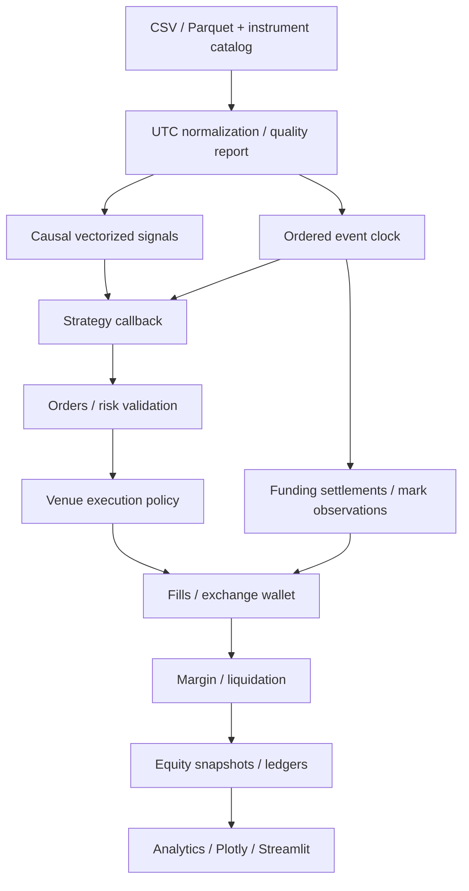

# Architecture — Aster Crypto Research

Design date: 2026-10-06. Original Python implementation; no framework cloned.

## Research-informed design
NautilusTrader's explicit order lifecycle and separate fill/accounting policies motivate event simulation. VectorBT's array-oriented signal calculation motivates a separate research layer. LEAN's security/venue abstraction and Hummingbot's venue-specific connectors motivate instrument metadata. Freqtrade's documented candle assumptions motivate explicit simulation limitations. Framework research and independent execution/derivative design precede implementation.

## Data architecture
Immutable instrument IDs combine venue, market type and exchange symbol. Catalog includes base/quote, listing and delisting timestamps, tick/lot/minimums and contract multiplier. One reporting quote currency per run; independent exchange wallets. Candle timestamp is interval START, end timestamp is start + duration. UTC timezone required. Funding and mark events have explicit timestamps; funding history is never attached to earlier candles. Quality report rejects duplicates, impossible OHLC, negative volume and naive timestamps; identifies gaps, outliers and outages. Missing periods are not forward-filled into tradable candles. Parquet is preferred persistent storage. L1/L2/trade schemas are extension contracts, not a claim of implemented order-book matching.

## Execution architecture
At an event timestamp: finish prior bars and publish them; settle funding on pre-existing positions; process opening prices and eligible orders; publish end-of-bar marks and enforce margin before strategy close callback. This tie convention is deterministic and documented. A signal using a finished candle may fill at the next interval open with zero latency, never its own close. Positive latency skips a bar when arrival is after its open. Intrabar limit eligibility uses completed bar extrema only for orders active before the interval; fills are timestamped at bar end, before the strategy observes the bar. Stop-market intrabar triggers activate for next open (gap-aware). Stop-limit similarly becomes a resting limit on the next bar. Conservative limits require strict trade-through and at least one prior resting interval; touch model is opt-in. Shared bar volume participation caps all non-liquidation fills. No artificial OHLC path is invented. Ambiguous intrabar liquidation is approximated using provided mark observations; trade extremes are not mark prices.

## Portfolio and margin
Spot is cash plus marked inventory and cannot short. Linear perpetuals maintain signed quantity and average entry; opening reserves initial margin and charges fees but does not exchange notional. Margin is reserved cash, not equity expense. Closing realizes signed P&L. Cross margin pools cash and derivative UPL within each venue. Isolated margin locks entry collateral, allocates realized P&L/funding/fees to position collateral, and excludes unrelated wallet funds from liquidation. Venue risk limits reject excessive opening size; reducing exposure remains possible during insolvency. Full liquidation uses mark-triggered detection and execution price plus configurable penalty; gap deficits are reported, not concealed. Insurance funds, ADL, tiered margin and exact venue liquidation waterfall are future policies.

## Funding architecture
Historical settlements are separate timestamped events. Payment=-signed_base_quantity*settlement_mark*rate. Positive rates charge longs and credit shorts. Settlement mark must be supplied; no future mark interpolation. Deduplicate settlements and expose rate to strategy only after settlement. Position round-trip ledger allocates funding pro rata on partial close.

## APIs and analytics
EventDrivenStrategy.on_bar(context, bar), on_funding(context, event), on_bars(context, completed_slice). Context exposes observed history, positions, order submission/cancellation and portfolio target helpers. Vectorized signals are computed causally and consumed only at their availability time. Parameter search evaluates full event simulations; walk-forward chooses on training only and evaluates a fresh out-of-sample wallet. Analytics use timestamp-aware daily 24/7 returns for risk ratios and explicitly distinguish closed trade results from total marked equity. Slippage is embedded in executed prices and reported diagnostically; it is never subtracted from fill-based P&L again.

## Reproducibility and scale
Save normalized config, strategy identity/version, git revision, runtime versions, UTC run time, data SHA256, instrument specs, source data semantics, seed, fill/slippage/margin policies with results. Export fills, completed trades, funding, events and equity as CSV/Parquet, plus self-contained interactive HTML. Benchmark actual simulation separately from vectorized research. Do not extrapolate measured timings into claimed full-universe results.
