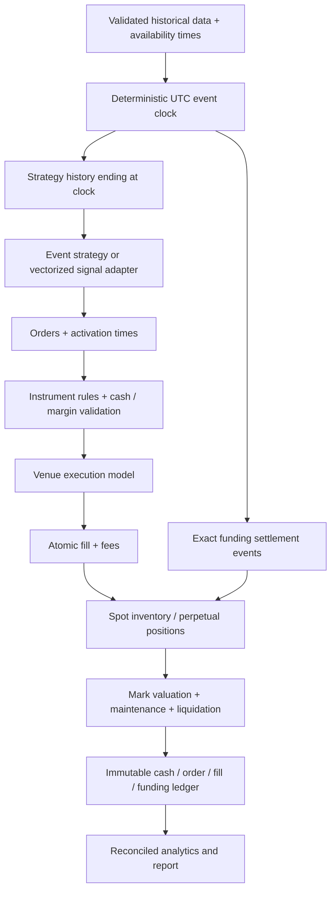

# Independent architecture challenge

This review was prepared before engine implementation by an agent assigned
execution research and independent review, not core engine authoring. It is a
design challenge; a final code audit must record tested findings separately.

## Recommended boundaries

Use a small event simulator as accounting authority and a vectorized indicator
and signal research layer. Vectorized output is a series of orders/signals with
explicit availability timestamps, never direct portfolio-equity authority.

Prefer an instrument key including venue and market type over naked symbols.
Keep quote currency, base quantity, contract multiplier, collateral currency,
tick/lot grids and listing intervals in metadata. Venue adapters normalize
external data and publish profiles; the engine must not import Binance logic.

## Failure modes that can create false profitability

| Severity | Failure | Required guard |
| --- | --- | --- |
| High | Current bar close informs same historical close fill | Closed-bar availability + future activation |
| High | Current total volume determines opening capacity | Previously available volume or truthful close-time fill |
| High | Stop and limit both reached; assume trigger then profit fill | Defer child or explicit conservative path model |
| High | Margin checks ignore fees / competing outstanding orders | Atomic candidate simulation and shared reserved capacity |
| High | Short opening proceeds become spendable spot cash | Separate derivative collateral and signed P&L |
| High | Funding follows entire bar even when position entered afterward | Exact settlement event and held-at-time quantity |
| High | Mark price replaced by profitable trade close for liquidation | Independent mark stream or prominent proxy flag |
| High | Wallets across venues pooled to fund losing leg | Venue accounts; explicit delayed transfer events |
| High | Real execution P&L minus slippage again | Price/cash conservation identity |
| Medium | Every limit fill charged maker fee | Liquidity classification per execution |
| Medium | Every order receives independent candle volume | One instrument capacity budget |
| Medium | IOC rests or FOK partially fills | One opportunity; atomic all-or-none decision |
| Medium | Pending reduce-only closes flip exposure | Recheck live signed position on each fill |
| Medium | Latest universe or tick rules used historically | Versioned universe/specification manifest |
| Medium | Symbol iteration exposes other symbols' newer data | Timestamp batches + immutable context cutoff |
| Medium | Final open positions omitted from ledger analytics | Reconcile realized + unrealized + costs to equity |

## Accounting invariants

1. Spot buy decreases quote cash by actual notional plus fee and increases base
   inventory; spot sell cannot short without explicitly implemented borrowing.
2. A linear perpetual opening changes collateral only through fees; notional
   is not a cash asset. Closing realizes `signed_closed_qty * (exit - entry) *
   multiplier`. Funding cash flow is `-signed_qty * mark * multiplier * rate`.
3. Equity is collateral/cash plus marked spot inventory plus perpetual unrealized
   P&L. Initial margin is a reservation, not an expense deducted from equity.
4. Reducing positions is permitted when the account lacks opening margin, but
   fees and insolvency remain recorded. Closing through a gap must not erase debt.
5. At every snapshot, account change reconciles to price P&L, actual fees,
   funding, liquidation penalties and external cash flows; slippage is not an
   additional cash deduction when included in fills.
6. Funding before first price observation needs its own valid mark observation;
   it cannot silently use the next candle's price. Duplicate settlements must
   fail or deduplicate explicitly, never charge twice.

## Scope gates

Ship a correct candle MVP with linear collateralized perpetuals and spot first.
Do not claim exact exchange replication, native L2 replay, realistic HFT,
inverse contracts, options, hedged account mode, isolated margin, ADL, transfers
or live execution merely because extension classes exist.

For cross margin, liquidating one position must be followed by revaluation:
whole-account insolvency may require more closes. Funding can itself cause a
maintenance breach. Stress-test large gaps and negative equity; synthetic
full-position liquidation is materially different from tiered partial exchange
liquidation and insurance-fund handling.

Store a run manifest with schema/version, data hash, strategy parameters, source
revision, instrument specs, fee profile, mark proxy, funding coverage, fill model,
latency, capacity proxy, tie-break ordering and seed. Dashboard labels should
surface approximations even on attractive results.

Do not prematurely optimize a ledger-rich engine by bypassing atomic account
updates. Benchmark it after invariants pass. A realistic multi-year, hundred-
symbol minute run may require streaming bars and a reduced snapshot cadence;
report measured small-scale benchmarks with size and extrapolation labelled.

## Audit acceptance

An independent auditor should not author the core. Require manual synthetic
expected values and adversarial tests, not only tests copied from implementation.
The final audit must list findings, corrections, regression coverage and residual
limitations, and rerun the full suite after all high/medium fixes.
